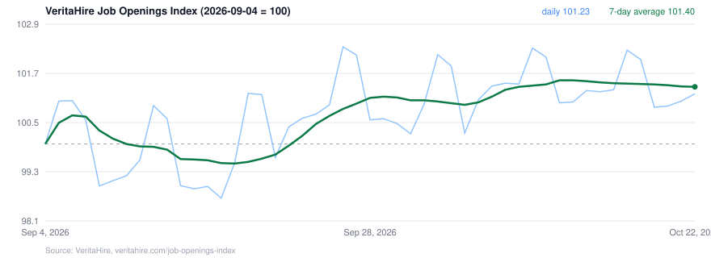

# US Job Openings Index (daily)

A daily index of how many jobs US employers have open, read straight from their own career sites,
published the next day. Free data, updated here every morning.



## Latest

<!-- latest:start -->
**101.41** (7-day average, 2026-09-04 = 100), data through **2026-10-26**, published 2026-10-27 08:25Z.

| | |
|---|---|
| Daily index | 100.77 |
| Change, 1 day | -1.10% |
| Change, 7 days | -0.10% |
| Change, 28 days | +0.28% |
| Change since 2026-09-04 | +1.41% |
| Employers in the panel | 24,804 |
| Open postings in the panel | 2,561,380 |
| New postings this week, share of open | 11.9% |
| Postings closed this week, share of open | 12.3% |
<!-- latest:end -->

## Why it exists

The official count of US job openings (the JOLTS survey) arrives about five weeks after the month it
describes, and job-board posting indexes about a week later. This index is published **the day after**,
from the employers' own career sites rather than from a survey or a job board.

- **Straight from the source.** VeritaHire reads the career sites of 25,000+ US employers every day
  (Workday, iCIMS, Greenhouse, Lever, SmartRecruiters, UKG and more). No job boards, no reposts.
- **A fixed, seasoned panel.** The index follows only employers whose boards we have read for at least 7 days, so
  a new employer's backlog never moves it. It is chained day to day, with 4 September 2026 = 100. The headline is a 7-day average because
  postings swing about 1.5% by day of the week.
- **Built to be checked.** The first published value of every day is kept beside the latest one, so every
  revision is visible. An employer whose board could not be read on a day is held out of that day rather
  than counted as closing its jobs. Always-hiring (evergreen) postings are left out, so the index measures
  real requisitions.

## The data

[`data/job-openings-index.csv`](data/job-openings-index.csv), one row per day:

| Column | Meaning |
|---|---|
| `date` | the day measured |
| `index` | the daily index, base date = 100 |
| `index_7d_avg` | 7-day average of the index (the headline) |
| `first_published` | the value first published for that day; differs from `index` when the day was revised |
| `panel_employers` | employers in the panel that day |
| `open_postings_in_panel` | open job postings at those employers |
| `weekly_posting_rate` | new postings in the last 7 days, as a share of open postings |
| `weekly_closing_rate` | postings closed in the last 7 days, as a share of open postings |
| `employers_excluded_board_event` | employers held out that day because their board could not be read cleanly |

[`data/latest.json`](data/latest.json) holds today's headline numbers. The method and the live chart are
at https://veritahire.com/job-openings-index/.

Use it straight from GitHub:

```python
import pandas as pd
df = pd.read_csv("https://raw.githubusercontent.com/veritahire/us-job-openings-index/main/data/job-openings-index.csv")
```

## More detail

The national index is free. Underneath it, VeritaHire publishes:

- **per-employer daily series** of postings opened, closed and live (back to June 2026), joinable to SEC
  tickers;
- **every live US job posting** (around 2.9 million) with pay, requirements and the employer's own apply link;
- **stuck and reposted requisitions** by state and industry.

API, files and pricing: https://veritahire.com/verified-jobs-feed/ · Questions and custom cuts:
data@veritahire.com

## Cite

> VeritaHire Job Openings Index, https://veritahire.com/job-openings-index/ (accessed YYYY-MM-DD).

See [CITATION.cff](CITATION.cff).

## License

The data is released under [CC BY 4.0](LICENSE-DATA.md): use it for anything, including commercial work,
with credit to "VeritaHire Job Openings Index". The update script is MIT ([LICENSE](LICENSE)).
